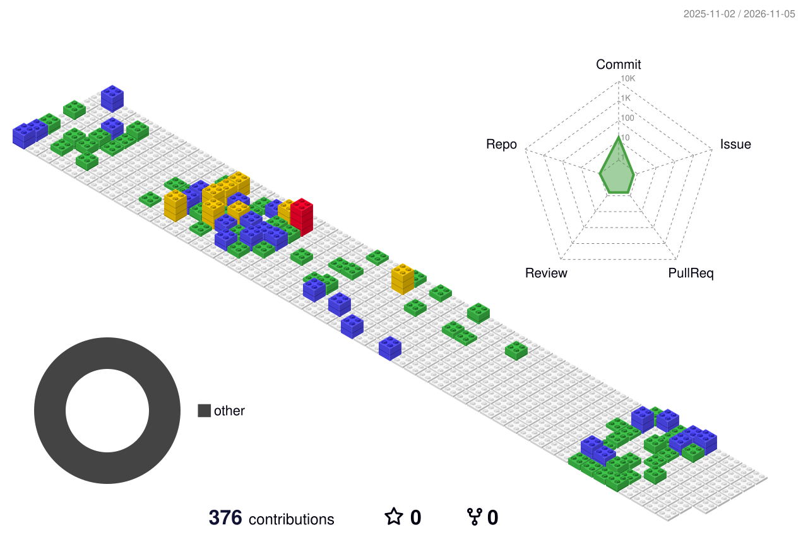

<div align="center">

# 📦 Cristian `v28.0.0`

**Frontend Tech Lead · React · TypeScript · Edge** <br/>
*Stable release. Battle-tested in 30+ markets.* <br/>
*Ships with sensible defaults.*


<br/><br/>

<br/><br/>


</div>

### 📖 README

A software engineer building platforms that stay fast under pressure, and a tech lead who loves seeing engineering work turn into measurable business impact. I've spent 8+ years making browsers behave and web applications scale without catching fire, mostly with React and TypeScript.

Most recently, Frontend Tech Lead for IKEA's in-store coworker apps. Currently freelancing, building my own SaaS, and exploring how LLMs and agents work under the hood (and occasionally questioning my life choices).

Strong believer in clean code and good developer experience, and mostly convinced we should have more of both.
<br/>Never deploy on a Friday.

```bash
$ npx cristian --help

  --lead        Lead a frontend team without the drama
  --architect   Monorepos, micro-frontends, edge infrastructure
  --debug       Blame the cache. Then actually fix it.
  --ship        Ship confidently. Panic responsibly.
```

### 🏅 Certifications

- **Leadership Principles** · Harvard Business School Online · 2025 · [verify ↗](https://online.hbs.edu/verify-certificate?dvid=CF4RN2A8)

### 📝 Changelog

#### Features
- **Multi-session carts** for store staff in 30+ markets: **+13% revenue**, **+8% productivity**
- **China launch** on Alibaba Cloud: **36% store adoption** in year one, **€300M order intake**
- **Edge router** on Cloudflare Workers handling auth, caching, security headers and ESI micro-frontends
- **~1,300 interactive learning games** in Three.js, adopted by Romania's Ministry of Education

#### Performance
- **CDN spend:** €160K → under €8K per month, zero downtime
- **Largest Contentful Paint −60%**, main bundle **−30%**, Core Web Vitals budgets enforced in CI

#### Team
- Built and led **6 engineers** with **0 attrition** over two years (plus a few promotions)

### 🧩 Dependencies

```json
{
  "frontend": ["React.js", "TypeScript", "Next.js", "Redux", "Zustand", "React Query", "Tailwind", "Sass"],
  "motion":   ["Three.js", "WebGL", "Framer Motion", "GSAP"],
  "tooling":  ["Vite", "Webpack", "Turborepo", "Storybook", "ESLint", "Prettier", "Biome.js"],
  "backend":  ["Node.js", "Express", "REST", "WebSockets", "PHP"],
  "data":     ["PostgreSQL", "MySQL", "Redis", "Supabase"],
  "edge":     ["Cloudflare", "Fastly", "Google Cloud Platform", "Alibaba Cloud", "Vercel", "Fastly"],
  "devops":   ["Docker", "Terraform", "GitHub Actions"],
  "testing":  ["Vitest", "Jest", "Testing Library", "Playwright", "Cypress", "MSW", "Lighthouse"],
  "observe":  ["Sentry", "Grafana"],
  "commerce": ["Shopify", "WooCommerce", "WordPress", "Stripe"],
  "design":   ["Figma", "Photoshop"],
  "copilots": ["Claude Code", "Codex", "GitHub Copilot"]
}
```

<div align="center">



<sub>⚠️ Most commits live in private enterprise repos. Public activity may appear lower than actual.</sub>

</div>

### 🐛 Known Issues

- Will politely suggest renaming your variables.
- Swedish support is in **beta** (patch in progress via SFI).
- Falls down **tech rabbit holes** for fun (yes, release notes count as bedtime reading).

### 🔋 Background Processes

- ♟️ Across a **chess** board, slowly losing rating points with style.
- 🏋️ At the **gym** or out for a **run**, pretending it's about fitness (it's mostly about stress).
- 🏂 Carving turns **snowboarding** when the mountain calls (it calls often).
- 🏸 Playing **football**, **volleyball** or **pool** with whoever's around.
- 🏎️ Watching **F1**, pretending I understand tyre strategy while yelling at the TV.
- 🍳 In the **kitchen**: half hobby, half therapy, occasionally edible.

### 🤝 Contributing

Issues, ideas and collaborations welcome.

[](mailto:tampacristianw@gmail.com)
[](https://www.linkedin.com/in/cristian-alexandru-tampa)
[](https://instagram.com/tampacristianw)
<br/>
<sub>Licensed under MIT: Malmö, Innovation & TypeScript.</sub>
